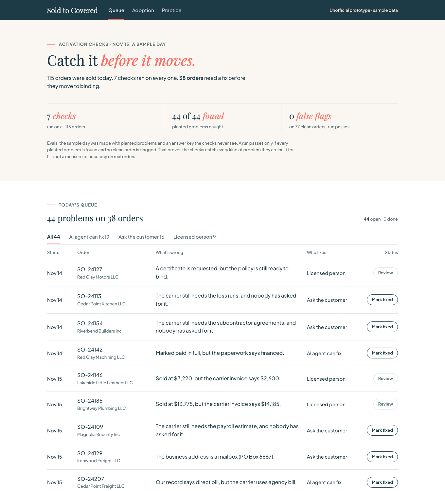

# Sold to Covered

**Live page:** https://duckky153.github.io/sold-to-covered/

An unofficial prototype of activation checks for small-business insurance orders, built for Harper's Forward Deployed Operator, Customer Operations role (the build-to-apply route). Sample data only. Not affiliated with Harper.

Harper's posting describes the problem: between "sold" and "covered", a financed deal gets marked as paid in full, a PO box gets listed as the business address, and a carrier needs a document nobody asked for. This page catches those problems before the deal moves to binding, and tracks whether the team actually uses the checks.

## What's on the page

- **Queue:** one sample day of 115 sold orders. Seven checks run on every order. Each problem gets one plain sentence, the evidence fields that caused it, one owner (a record fix an AI agent could make, something only the customer can send, or a licensed person's call), a next step, and a "How to fix" card. Customer messages stop at a Copy button. Fixing a licensed person's flag asks who confirmed it; dismissing or forcing a bind asks why.
- **Adoption:** what gets tracked once the checks are on the floor, the main number being orders that moved to binding with a flag still open. The two-week rollout shown is simulated and labeled that way.
- **Practice:** ten orders with planted problems, scored against an answer key, pass mark 9 of 10. This is how a new teammate learns the checks before touching a live order.

## How it works

- `site/data/checks.json` holds the seven checks as data: the fields each one reads, the rule, who fixes it, the next step and the customer message. A new check that uses an existing kind of rule is one more entry.
- `site/engine.js` runs every check on every order and builds the evidence. No AI model makes the calls, so the same order always gets the same answer.
- `generate.py` makes the sample day with a fixed seed, plants 44 problems in 38 orders, and writes an answer key the checks never see.
- **Evals:** a run passes only if every planted problem is found and no clean order is flagged (currently 44 of 44 found, 0 false flags on 77 clean orders). This is a regression test. It shows each check works and keeps working after a change. It is not a measure of accuracy on real orders.

## Run it locally

    ./run.sh        # serves site/ at http://127.0.0.1:5110/

## Tests

    node --test tests/
    python3 -m pip install pytest && python3 -m pytest -q tests/test_generate.py

## Limits

- Every business, person, carrier and amount is made up.
- The checks cover the seven problems named in Harper's postings, not every real activation problem.
- No insurance judgment is made anywhere. Price and coverage questions go to a licensed person.
- Nothing is sent to anyone. Your clicks are stored only in your own browser.

See `docs/ROLLOUT.md` for how the checks would go from a two-person pilot to the whole floor.

Built by Dakshit Raj.
