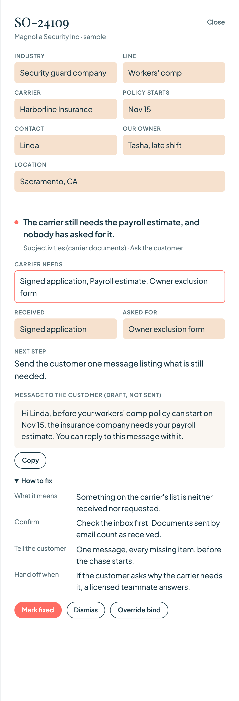
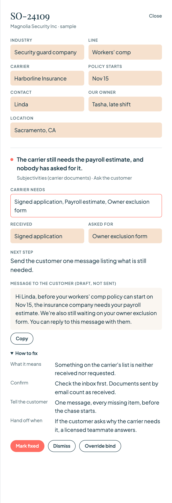
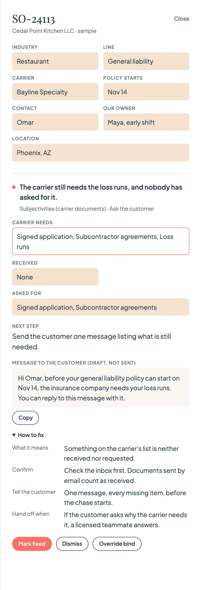
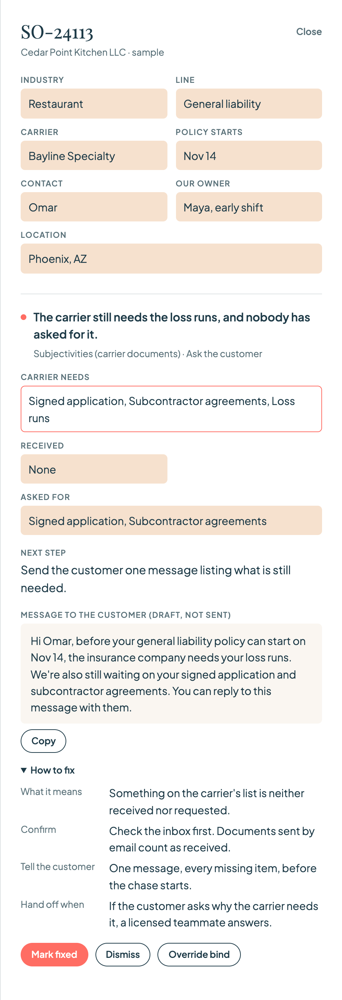

# Fix: the customer message now lists every missing document

Issue: [#1](https://github.com/Duckky153/sold-to-covered/issues/1). Found 2026-11-14 while clicking through the build.

## What was wrong

On SO-24109 (Magnolia Security Inc) the carrier needs a signed application, a payroll estimate and an owner exclusion
form. The draft message to the customer only asked for the payroll estimate. The panel's own rule says
"One message, every missing item, before the chase starts", so the message should have said more. SO-24113
(Cedar Point Kitchen LLC) had the same problem: three documents needed, the message asked only for the loss runs.

## Why

The flag is about documents nobody has asked for yet, and the message was built from that same list. Documents
that were asked for earlier but never came in were left out of the message.

## What changed

- The check now also collects the documents that were asked for but have not come in (`remind_from` in
  `site/data/checks.json`, read in `site/engine.js`).
- The message names the new document, then adds "We're also still waiting on your ..." when anything else is
  outstanding. With nothing else outstanding, the message reads exactly as before.
- Message templates can have an optional part in `[[ ... ]]`, which is left out when it has nothing to show.
- The flag itself did not change: the same 44 flags, and the evals still find 44 of 44 planted problems.
- New test in `tests/engine.test.mjs` covers both orders and the single-document case.

In the sample day, 6 of the 10 document flags now include the reminder line.

## Before and after

| | Before | After |
|---|---|---|
| SO-24109 |  |  |
| SO-24113 |  |  |

SO-24109 message after the fix:

> Hi Linda, before your workers' comp policy can start on Nov 15, the insurance company needs your payroll estimate.
> We're also still waiting on your owner exclusion form. You can reply to this message with them.
